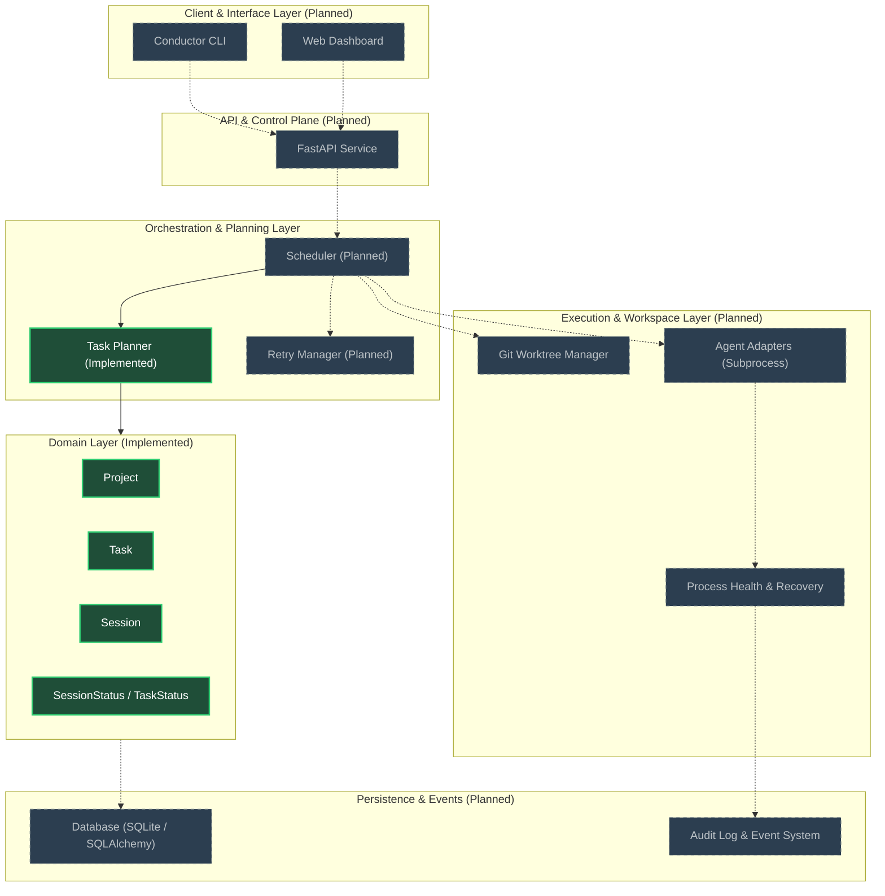

# Conductor

> **One control plane. Multiple agents. Coordinated execution.**

Conductor is a local-first multi-agent coding orchestration platform designed to coordinate multiple autonomous AI coding agents working concurrently on complex software development tasks.

[](https://www.python.org/)
[](https://github.com/astral-sh/uv)
[](https://fastapi.tiangolo.com/)
[]()

> [!NOTE]
> **Project Status:** Early Development / MVP in Progress.
> Conductor is currently in active foundation development. Core domain entities (Project, Task, Session) and a dependency-aware Task Planner are implemented. Execution layers, workspace isolation, and API services are planned.

---

## 1. What is Conductor?

Conductor provides a central control plane for running and managing multiple autonomous coding agents.

**Conductor is not an AI chatbot or an LLM wrapper.** It is developer infrastructure that coordinates coding agents. The agents perform the software development work (modifying files, running commands, debugging, testing); Conductor manages their scheduling, dependency ordering, workspaces, lifecycle, and failure recovery.

---

## 2. Problem Statement

Autonomous coding agents (e.g., Claude Code, Codex, Aider) are transforming individual programming tasks. However, scaling beyond single-prompt edits to multi-step software objectives introduces operational challenges:

- **Task Coordination:** Decomposing complex engineering goals into discrete tasks and executing them in correct topological order.
- **Dependency Management:** Preventing dependent work from running before prerequisites complete, while identifying parallel execution opportunities.
- **Parallel Execution & Conflicts:** Running multiple agents simultaneously on the same codebase without file collisions or merge contention.
- **Workspace Isolation:** Providing each agent run with an isolated, clean working directory.
- **Process Monitoring:** Tracking whether agent processes are alive, stuck, waiting for input, or unexpectedly aborted.
- **Failure Recovery:** Reconciling crashed or interrupted sessions, distinguishing process crashes from task failures, and managing retries.
- **Execution History:** Maintaining an auditable record of task attempts, agent sessions, and outcome logs.

Conductor addresses these problems by decoupling planning, workspace management, and session monitoring into a unified, local-first orchestration service.

---

## 3. Vision & Intended Workflow

In the target Conductor workflow:

1. **Objective Submission:** A developer or high-level coordinator submits a development objective for a registered project.
2. **Task Decomposition:** The objective is structured into a directed graph of `Task` entities with explicit dependencies.
3. **Dependency Planning:** Conductor's `Task Planner` evaluates dependency completion and outputs ready tasks.
4. **Workspace Isolation:** For each ready task, Conductor provisions an isolated Git worktree on a dedicated branch.
5. **Agent Scheduling & Dispatch:** Conductor selects an appropriate agent adapter, instantiates a `Session`, and launches the agent subprocess within its dedicated workspace.
6. **Supervision & Recovery:** Conductor monitors process health, handles abnormal host interruptions, logs execution streams, and updates task statuses.
7. **Feedback & Integration:** When an agent finishes, test suites run, diffs are reviewed, and successful changes merge back to the target branch.

*(Note: The workflow above represents the architectural target. Refer to [Current Implementation Status](#6-current-implementation-status) for what is currently running.)*

---

## 4. Architecture

Conductor is architected into layered, decoupled subsystems to prevent execution and planning logic from becoming tangled:



### Layer Responsibilities

- **Domain Layer:** Pure Python data entities (`Project`, `Task`, `Session`) and lifecycle enums (`TaskStatus`, `SessionStatus`). Zero external framework dependencies.
- **Orchestration Layer:**
  - `Task Planner` (Implemented): Pure function calculating task eligibility from dependency graphs.
  - `Scheduler` (Planned): Dispatches eligible tasks to agent workers according to concurrency limits.
  - `Retry Manager` (Planned): Evaluates failure causes, backoff, and retry limits independently of task planning.
- **Git Workspace Manager** (Planned): Creates, tracks, and cleans up isolated Git worktrees per session.
- **Agent Adapter Layer** (Planned): Subprocess execution harnesses wrapping coding agents (Claude Code, Codex, CLI tools), capturing stdout/stderr, and managing process lifecycles.
- **Monitoring & Recovery** (Planned): Heartbeats, process health checks, and reconciliation of `INTERRUPTED` sessions after Conductor restarts.
- **API & Persistence** (Planned): FastAPI endpoints exposing the control plane, backed by SQLite/SQLAlchemy for persistent state.

---

## 5. Core Domain Concepts

| Concept | Status | Description |
|---|---|---|
| **`Project`** | Implemented | Represents a software repository registered with Conductor. Holds a name, UUID, creation timestamp, and local `pathlib.Path` repository location. |
| **`Task`** | Implemented | Represents a discrete unit of development work belonging to a project. Contains description, UUID, `TaskStatus`, creation timestamp, and an immutable `tuple` of dependency task IDs. |
| **`Session`** | Implemented | Represents a single execution attempt of a task by a specific agent. Contains UUID, project reference, task reference, agent identifier, `SessionStatus`, and creation timestamp. |
| **`Agent`** | Planned | Abstraction representing an external AI coding tool (e.g. Claude Code, Codex, Custom CLI) and its invocation configuration. |
| **`Workspace`** | Planned | Abstraction representing the isolated filesystem working directory (Git worktree) assigned to a session. |

---

## 6. Current Implementation Status

| Component | Status | Details |
|---|---|---|
| **Python Project Foundation** | Implemented | Python `>=3.14` package setup using `uv`, deterministic lockfile (`uv.lock`), `src` layout. |
| **Session Domain Model** | Implemented | Dataclass with UUID identity, UTC timestamps, and `SessionStatus` lifecycle enum (distinguishing `FAILED` from `INTERRUPTED`). |
| **Project Domain Model** | Implemented | Dataclass with UUID identity, UTC timestamps, and `pathlib.Path` repository path. |
| **Task Domain Model** | Implemented | Dataclass with UUID identity, `TaskStatus` lifecycle enum, and immutable `tuple` dependencies. |
| **Task Planner** | Implemented | `find_ready_tasks()` pure function providing dependency-aware eligibility resolution. |
| **FastAPI Service & Endpoints** | Planned | FastAPI, Uvicorn, and Pydantic Settings installed as dependencies; REST endpoints not yet implemented. |
| **Database Persistence** | Planned | Storage abstraction and SQLite / SQLAlchemy integration not yet implemented. |
| **Git Worktree Manager** | Planned | Branch creation, worktree provisioning, and cleanup not yet implemented. |
| **Agent Adapters** | Planned | Subprocess harnesses for external coding agent CLIs not yet implemented. |
| **Retry Manager** | Planned | Failure evaluation and retry policies not yet implemented (decoupled from Task Planner). |
| **Multi-Agent Execution Engine** | Planned | Concurrency scheduling, process supervisor, and event dispatch not yet implemented. |

---

## 7. Technology Stack

### Installed & Configured

- **Language:** Python `>=3.14`
- **Package Management:** [uv](https://github.com/astral-sh/uv) (fast Python package and project manager)
- **Web Framework:** [FastAPI](https://fastapi.tiangolo.com/) `>=0.162.0` (installed dependency)
- **Settings & Validation:** [Pydantic Settings](https://docs.pydantic.dev/) `>=2.16.2` (installed dependency)
- **ASGI Server:** [Uvicorn](https://www.uvicorn.org/) `>=0.54.0` (installed dependency)
- **Testing:** [pytest](https://docs.pytest.org/) `>=9.2.0`, [pytest-asyncio](https://github.com/pytest-dev/pytest-asyncio) `>=1.4.1.post1`

### Planned Integrations

- **Database / ORM:** SQLite with SQLAlchemy (for relational state persistence)
- **Process Management:** Python `asyncio` subprocess execution
- **Workspace Isolation:** Git worktrees via Git CLI / system calls
- **Code Quality:** Ruff (linter and formatter)

---

## 8. Local Setup

### Prerequisites

- Git
- Python 3.14+
- [uv](https://docs.astral.sh/uv/getting-started/installation/)

### Setup Instructions

1. **Clone the repository:**
   ```bash
   git clone https://github.com/urooj-vX/Conductor.git
   cd Conductor
   ```

2. **Install dependencies:**
   ```bash
   uv sync
   ```

3. **Run the test suite:**
   ```bash
   uv run python -m pytest
   # or
   uv run pytest
   ```

4. **Run the application entry point:**
   ```bash
   uv run conductor
   ```
   *(Currently outputs initial package confirmation message: `Hello from conductor!`)*

---

## 11. License

Licensing terms for this project are currently pending. No open-source license has been formally applied to this repository yet. All rights reserved.
